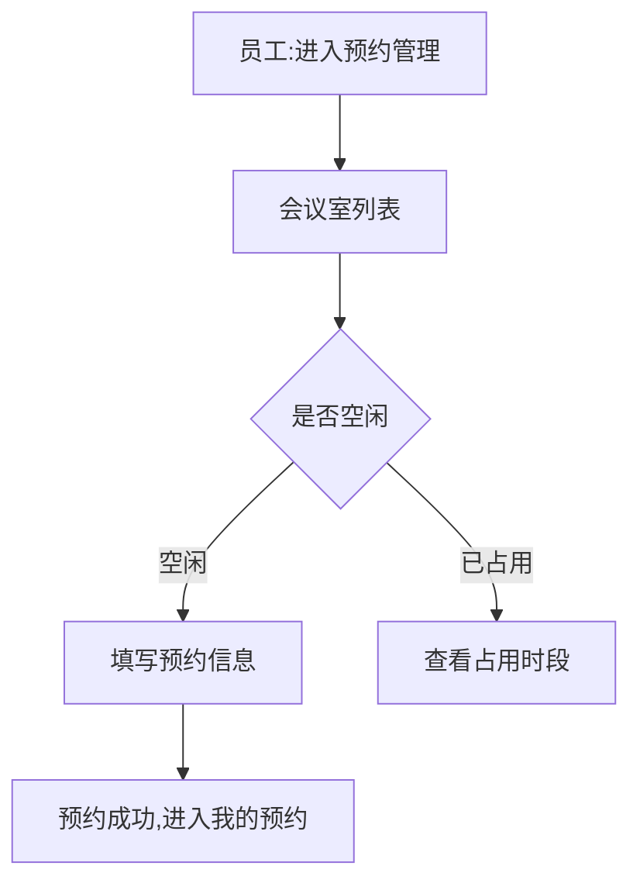

> 📌 **格式参考样本(虚构业务)**:本文档为虚构的「会议室预约」小样本,不对应任何真实组织、产品或系统,
> 仅用于说明本 SKILL 输出的**章节编号 / 页面规格表 / 权限描述 / 弹框交互 / 字典枚举表 / 待澄清分级**等版式。
> 体量刻意精简;字段、规则、数字均为示例,⛔ 不得当作业务事实引用。
> 每个功规点段头的四类来源标注、表 A(需求字段清单)与表 D(PRD 条目映射表)按模式 B(有产品需求文档)演示;
> 链接指向的产品需求与原型文件同为虚构路径,仅示意「markdown 链接 + 相对路径 + 锚点」写法。
> 章节骨架(一~十)与 [`../flow-upstream-refs.md`](../flow-upstream-refs.md) 的输出骨架逐章对应;
> 「十、待澄清问题清单」7 列 + 暂行方案必填是维度 11 的硬要求,照抄本样本不会被自家 QR 判死。

# 会议室预约 — 功能规格说明书(示例)

|**文档版本**|V0.1|
| :-: | :-: |
|**文档状态**|示例|
|**生成模式**|模式B：融合增强|
|**产品需求文档**|[会议室预约产品需求](../产品需求/会议室预约产品需求.md)|
|**原型来源**|[原型目录](../原型/index.html)|

> ⚠️ **已剥离技术细节**(模式 B 上游净化阶段处理):本样本的产品需求文档无接口 / 数据表 / 技术栈内容,无剥离项。

## 一、需求背景

> **PRD 来源：** [产品需求 §1 产品背景](../产品需求/会议室预约产品需求.md#1-产品背景)
> **原型来源：** [<AppShell>](../原型/index.html#app-shell)
> **高保真来源：** 无
> **关联功规点：** 无

为 demo-app 内部员工提供会议室查询、预约、取消与使用记录查看能力,减少会议室冲突与空占。

用户故事:As a 普通员工,I want 按日期查看空闲会议室并直接预约,So that 不用逐间询问是否被占用。

## 二、术语说明

|**术语 / 缩略词**|**说明**|
| :-: | :-: |
|时段|以 30 分钟为粒度的预约单位|
|空占|已预约但未实际使用的会议室时段|

## 三、业务流程与逻辑图

## 四、角色权限说明

> **PRD 来源：** [产品需求 §2 用户角色](../产品需求/会议室预约产品需求.md#2-用户角色)
> **原型来源：** [<RoleSwitch>](../原型/index.html#role-switch)
> **高保真来源：** 无
> **关联功规点：** 无

| 角色编码 | 角色名称 | 角色描述 |
| :- | :- | :- |
| ROOM_ADMIN | 会议室管理员 | 维护会议室信息,可查看全部预约记录 |
| EMPLOYEE | 普通员工 | 预约、取消本人的会议室预约 |

## 五、页面交互明细

#### 5.1 会议室列表

> **PRD 来源：** [产品需求 §3.1 会议室列表](../产品需求/会议室预约产品需求.md#3-1-会议室列表)
> **原型来源：** [<RoomListPage>](../原型/room-list.html#room-list-page)
> **高保真来源：** 无
> **关联功规点：** 无

面包屑:首页/预约管理/会议室列表

|**页面元素**|**功能说明**|
| :- | :- |
|页面整体描述|按日期展示全部会议室及其当日占用情况|
|初始化约束|默认展示当天;仅展示状态为「可用」的会议室|
|初始焦点|日期选择框|
|权限要求|
1、 会议室管理员:查看全部会议室,可新增、编辑、停用会议室;

2、 普通员工:查看可用会议室,可预约;
|
|数据来源|来自会议室管理模块维护的会议室信息与当日预约记录|
|易用性|已占用时段以灰色块标示,鼠标悬停显示预约人|
|交互方式|点击「预约」按钮进入预约表单;点击会议室名称进入详情|

**字段列表**:见 六·4 表 A-1。

**操作约束:**

- 点击"预约"按钮(已停用的会议室不可预约)
- 点击"停用"按钮(存在未开始的预约时不可停用,提示"该会议室仍有未开始的预约,请先处理")

#### 5.2 预约表单

> **PRD 来源：** [产品需求 §3.2 预约](../产品需求/会议室预约产品需求.md#3-2-预约)
> **原型来源：** [<BookingForm>](../原型/booking-form.html#booking-form)
> **高保真来源：** 无
> **关联功规点：** [五-1 会议室列表](#51-会议室列表)(从列表「预约」按钮进入)

**第一步:选择时段**

1) 日期:默认当天,不可选择过去的日期;
2) 时段:以 30 分钟为粒度,同一会议室同一时段只能被预约一次;

**第二步:填写会议信息**

1) 会议主题:必填,最多输入 50 个字符;
2) 参会人数:必填,不得大于会议室容纳人数,超出提示"参会人数不能超过会议室容纳人数";

【预约冲突】见 八、异常路径处理。

#### 5.3 我的预约

> **PRD 来源：** [产品需求 §3.3 我的预约](../产品需求/会议室预约产品需求.md#3-3-我的预约)
> **原型来源：** [<MyBookingPage>](../原型/my-booking.html#my-booking-page)
> **高保真来源：** 无
> **关联功规点：** [五-2 预约表单](#52-预约表单)(预约成功后进入)

点击"取消预约"按钮,弹框提示"确定要取消这条预约吗?"

- 点击"确认":取消预约,提示"取消成功",刷新列表
- 点击"取消":关闭弹框,回到当前页面

## 六、字段规格表

### 六·4、需求字段清单

##### 表 A-1 会议室列表·会议室信息(来源:原型 `room-list.html#room-table`)

| 字段语义名称 | 展示形态 | 展示顺序 | 是否筛选项 | 业务含义 |
| :- | :- | :-: | :-: | :- |
| 会议室名称 | 文本 | 1 | 否 | 必填,最多输入 20 个字符;点击进入详情 |
| 容纳人数 | 数字 | 2 | 否 | 必填,1~50 的整数 |
| 所在楼层 | 枚举标签 | 3 | 是 | 必填,下拉选择,支持按楼层筛选 |
| 设备 | 枚举标签 | 4 | 否 | 选填,多选:投影 / 白板 / 视频会议 |
| 操作 | 操作按钮 | 5 | 否 | 预约 / 停用按钮组,按角色显示 |

##### 表 D-1 PRD 条目映射表(来源:产品需求文档 `会议室预约产品需求.md`)

| PRD 位置 | 条目内容 | 研发需求落点 | 处置 |
| :- | :- | :- | :- |
| §3.1 字段说明表 | 会议室名称(备注:最多 20 个字符,点击进入详情) | 五-1 / 六·4 表 A-1 | 已承接 |
| §3.1 字段说明表 | 容纳人数(备注:1~50 的整数) | 五-1 / 六·4 表 A-1 | 已承接 |
| §3.1 操作描述表 | 「预约」操作(已停用会议室不可预约) | 五-1 操作约束 | 已承接 |
| §3.1 操作描述表 | 「停用」操作(有未开始预约时不可停用) | 五-1 操作约束 | 已承接 |
| §3.3 操作描述表 | 「取消预约」操作(二次确认) | 五-3 我的预约 | 已承接 |
| §5 迭代建议表 | 会议开始前提醒通知 | — | 本版不做 |

> 「本版不做」条目已登记待澄清清单 Q-ITEM-001。

## 七、字典枚举表

#### 预约状态

| 状态编码 | 显示文本 | 颜色 | 可执行操作 | 触发条件 |
| :- | :- | :- | :- | :- |
| PENDING | 未开始 | 蓝色 | 取消预约 | 当前时间早于预约开始时间 |
| IN_USE | 使用中 | 绿色 | 查看 | 当前时间处于预约时段内 |
| FINISHED | 已结束 | 灰色 | 查看 | 当前时间晚于预约结束时间 |
| CANCELED | 已取消 | 灰色 | 查看 | 预约人主动取消 |

### 七·3、隐藏逻辑说明

- 列表页单日会议室数量预计 ≤ 50 间,不分页;
- 预约记录保留 180 天,超期记录不在「我的预约」中展示。

## 八、异常路径处理

- 【预约冲突】提交时若该时段已被他人预约,提示"该时段已被预约,请重新选择",停留在第一步。

## 九、验收测试点

1、 已停用的会议室在列表中不出现「预约」按钮;
2、 同一会议室同一时段第二次预约时提示"该时段已被预约,请重新选择";
3、 取消预约须经二次确认,确认后列表刷新且该预约状态为「已取消」。

## 十、待澄清问题清单

| 序号 | 主题 | 影响范围 | 待澄清问题描述 | 🔧 Agent 暂行方案 | 优先级 | 用户确认状态 |
| :-: | :- | :- | :- | :- | :-: | :-: |
| Q-001 | 跨天会议 | 五-2 预约表单 | 跨天会议(如 23:30~00:30)是否允许预约? | 不允许跨天,结束时间最晚 23:59 | P0 | ⏳ 待确认 |
| Q-002 | 代他人预约 | 五-2 预约表单 / 四、角色权限说明 | 会议室管理员能否代他人预约? | 本版不支持代预约,管理员与普通员工同样只能为本人预约 | P1 | ⏳ 待确认 |
| Q-003 | 会前提醒 | 五-3 我的预约 | 是否需要会议开始前的提醒通知? | 本版不做,列入后续迭代 | P2 | ⏳ 待确认 |
| Q-ITEM-001 | 迭代建议「会前提醒」本版不做 | 六·4 表 D-1 | 产品需求 §5 迭代建议「会议开始前提醒通知」本版不做,是否认可? | 按本版不做处理,表 D 处置记「本版不做」 | P2 | ⏳ 待确认 |
